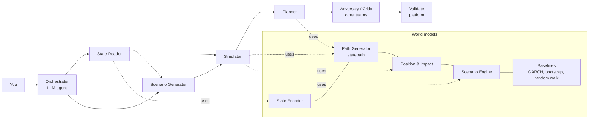

# MIKO world-model agents

**State Reader · Simulator · Scenario Generator · Planner.** Working, tested (55 tests) and benchmarked on public data, out of sample.

These are the four *world-model agents* from the MIKO team brief (section 04). World-model agents compute: their outputs are numbers, paths and plans, never prose. LLMs appear only where the brief allows: they *propose* (turn "S&P -20%, oil +40%" or "keep monthly CVaR under 6%" into a structured spec), and the world models *check* before anything is computed. Every result follows the brief's result anatomy (section 08): source badges on every number (`SIM` / `DATA` / `CALC`), distributions instead of single answers, a count-based read-out ("In 7 of 20 simulated futures…"), provenance (model, cutoff, seed, data snapshot) and a trial id from the trial ledger.

The lab's own learned world models were not available yet, so this repo ships stand-in world models behind a common interface (`PathModel`). Plug the lab's Path Generator or State Encoder into the same interface and the agents, tests and benchmark harness work unchanged. See [Plugging in the lab's world models](#plugging-in-the-labs-world-models).

## Results at a glance

Every forecast is point-in-time: each model sees only data dated before it. Model choices were made on earlier validation periods, with two exceptions noted under [Negative results](#negative-results-and-what-we-changed). Full tables are in `results/`. Significance means p < 0.05.

| Agent | Benchmark (public data) | World model | Comparison | Verdict |
|---|---|---|---|---|
| Simulator | **Exchange-rate CRPS-sum** (GluonTS `exchange_rate_nips`, the split used by GP-Copula, TimeGrad, ScoreGrad) | **0.0048** ± 0.0002 | published: TimeGrad 0.006, ScoreGrad 0.006, GP-Copula 0.007, GARCH 0.023; VAR / VES / Transformer-MAF 0.005 (rounded) | Better than TimeGrad, ScoreGrad, GP-Copula, Vec-LSTM, KVAE and GARCH; level with VAR, VES and Transformer-MAF. The gain comes from the GJR-GARCH filter: plain FHS scores 0.00474 |
| Simulator | S&P 500 risk bands, 2000-2022 (5,758 days) | 1-day CRPS 59.39, FZ0 -3.625 | GJR-GARCH-t 59.60, -3.555; GARCH(1,1)-t 60.00, -3.517 | Better than both GARCH baselines on all four 1-day scores (DM p ≤ 0.014). The VIX state head beats the no-state version on 1-day CRPS (p = 0.0001) and FZ0 (p = 0.02), not at 10 days |
| State Reader | Next-21-day S&P 500 volatility | log-vol MSE **0.1186** | GJR-GARCH 0.1334, HAR 0.1445; VIX alone 0.1180 | On log-vol MSE beats GARCH, GJR, HAR and EWMA (DM p ≤ 0.008); ties the VIX alone. On QLIKE ties GARCH and GJR |
| State Reader | NBER recession days (public label), filtered, no look-ahead | AUC **0.910** | GJR-GARCH vol 0.866, VIX 0.857, below-MA200 0.849 | Highest AUC; significant only vs MA200 (year-block bootstrap; just 3 recessions in the test) |
| Scenario Generator | Fill in 20 stocks from S&P, VIX and oil moves in 11 hold-out crises (2008-2022) | 90% intervals cover **89%** | Gaussian conditioning 78%, CAPM beta 83% | Better coverage than Gaussian in 7 crises, never worse (p = 0.016). Point accuracy ties Gaussian; CAPM beta is more accurate. Over all windows (calm and stressed) worse than Gaussian conditioning |
| Planner | 20 US large caps, monthly 1995-2022, goal "21-day CVaR95 ≤ 6%" | realized CVaR95 **6.2%** (crisis months 6.3%) | same 1/N sized with 2-year historical risk: 7.5% (crisis 9.4%) | Lands near the goal (months losing more than 6%: 1.8%) where historical risk overshoots; Sharpe 1.12 vs 0.97 (p = 0.003). GARCH-t and GJR sizing also beat historical sizing; the VIX state head adds nothing over plain FHS |

The short version: the GARCH-filtered path generator is the workhorse and beats the brief's baselines (GARCH, block bootstrap, random walk) and, on Exchange, the published deep models except Transformer-MAF (parity); the State Reader's regimes and VIX-based risk read the market well; the state conditioning helps 1-day risk bands but not the Planner or the FX benchmark. What did *not* work is in [Negative results](#negative-results-and-what-we-changed), and it matters as much as the wins.

## Quick start

```bash
pip install -e ".[dev,bench]"        # numpy pandas scipy scikit-learn statsmodels arch hmmlearn cvxpy skfolio (+ pytest, gluonts)
pytest -q                            # 55 tests, ~1 minute
python scripts/demo.py               # runs all four agents, saves results/examples/ and checkpoints/
bash scripts/run_all_benchmarks.sh   # reproduces every table in results/ (~40 min on 2 cores)
```

Data downloads itself on first use (public sources, see `miko/data.py`); no API keys are needed. The LLM layer defaults to a deterministic rule-based parser; set `MIKO_LLM=gemini|groq|ollama` to use a model.

```python
from miko.agents import StateReader, Simulator, ScenarioGenerator, Planner, Goal

as_of = "2022-12-28"
book = {"AAPL": 0.2, "MSFT": 0.2, "JPM": 0.2, "XOM": 0.2, "PG": 0.2}

print(StateReader().run(as_of).card())
print(Simulator().run(as_of, book, orders={"AAPL": 250_000}, adv={"AAPL": 1e10}).card())
print(ScenarioGenerator().run(as_of, narrative="S&P -20%, oil +40%, VIX to 45, Fed on hold", book=book).card())
print(Planner().run(as_of, universe=list(book), goal_text="keep monthly CVaR under 6%, max 20% per name").card())
```

Example output (`results/examples/simulator.txt`, abridged):

```
Simulator · as of 2022-12-28
In 3 of 20 simulated futures the book loses more than 5% within 21 trading days (341 of 2000 paths).
  Median return: +2.2% [SIM]
  5th percentile return: -10.3% [SIM]
  CVaR 95% (expected loss in worst 5%): 14.8% [SIM]
  Max drawdown, worst 5% of futures: -14.2% [SIM]
  Trading cost incl. estimated impact: 1.0 bps [CALC]
  Model disagreement: range of VaR 95% across models: 3.0% [SIM]
  Model: statepath v2 (cutoff 2022-12-28), state-encoder v1 (cutoff 2022-12-28), garch-t v1 ... · seed 0 · data d-64e58446 · trial 222255d1cd (#1 in lineage)
  Simulated. Not a forecast of returns.
  Impact estimated, not reactive: in v1 your orders do not move simulated prices.
```

## Where the agents sit in MIKO



LLM parsing (narratives, goals) sits in `miko/core/llm.py`. It proposes a JSON spec; the agent rejects any factor the world model doesn't know and **any number that is not in the user's own text** (trust rule 2: LLMs never produce a number).

## The four agents

### State Reader (`miko/agents/state_reader.py`)
*Reads regime, closest past periods, novelty.*
- **Regime:** a 4-state Gaussian hidden Markov model over six state features (realized vol, trend, drawdown, VIX, stock correlation), read with *forward-filtered* probabilities so today's regime never uses tomorrow's data. States are named by volatility: calm, normal, elevated, crisis.
- **Closest past periods:** nearest neighbours in a standardized 13-feature state space, restricted to dates whose following 63 days had fully happened before the run date, at least 42 trading days apart, each with what followed (DATA).
- **Novelty:** mean distance to the 20 nearest past states, as a percentile of how unusual past days were. Above the 95th percentile the agent warns that bands should be read wide.
- **Forward risk:** next-21-day volatility (HAR-style realized vols + VIX) and the probability of a 7%+ drawdown.

### Simulator (`miko/agents/simulator.py`)
*Runs futures with your book attached.*
Generates thousands of futures from today's state with the world model, applies trading costs and square-root impact to your orders (estimated, not reactive, as the brief requires for v1), and reports median, 5-95% range, VaR/CVaR 95/99, drawdowns, a count read-out and a fan chart table. GARCH-t, block bootstrap and random walk always run alongside on the same book, and *model disagreement* (range of VaR across models) is reported separately from the normal spread.

### Scenario Generator (`miko/agents/scenario_generator.py`)
*Turns shocks into full paths.*
Takes shocks (`{"SP500": -20, "WTI": 40}`) or a sentence, scores how extreme they are against every past 21-day window, fills in all other factors with the Scenario Engine, and bridges world-model paths so every path hits the shocks exactly. Replay mode re-runs a real window with one thing changed (`replay("2020-02-24", {"WTI": 20})`: Covid with oil up 20% instead of down 56%). Parts of a narrative outside the factor set ("Fed on hold") are reported as ignored, never invented.

### Planner (`miko/agents/planner.py`)
*Finds weights that meet a risk goal; trains policies.*
- **Weights:** simulates futures, then solves a convex program: invest as much as the goal allows (flat return prior, because world models are for risk, not return forecasts), with a small L2 term for stability and turnover costs. Goals: CVaR 95% (Rockafellar-Uryasev LP), annualized volatility, or CDaR 95% drawdown (Chekhlov-Uryasev-Zabarankin). The plan is then checked on a second set of futures the optimizer never saw and scaled back if it breaches. `mode="scale"` keeps a composition (1/N by default) and only sizes it, which the benchmark favours. Infeasible goals are refused.
- **Policies:** `train_policy` learns an exposure rule (vol targeting with a drawdown brake) inside simulated years, tests it on other models' futures (GARCH-t, bootstrap), and confirms it on real history after the training date next to buy-and-hold and a plain vol target. All candidates count as trials.

## World models (stand-ins, `miko/worldmodels/`)

| Brief component | Here | How it works |
|---|---|---|
| State Encoder | `state_encoder.py` | Standardized trailing features → filtered HMM regimes, kNN analogs, kNN novelty, small forward-risk head |
| Path Generator | `paths.py: StatePath` | GJR-GARCH(1,1) filter per asset; jointly resampled standardized residuals (keeps cross-asset dependence); a learned state head rescales horizon variance with the VIX (GARCH-X/HAR-X style), trained only on windows closed before the cutoff |
| Position & Impact | `impact.py` | commission + half spread + Y·σ·√(Q/ADV), Y = 0.7; refuses without ADV |
| Scenario Engine | `scenario_engine.py` | "Stress covariance": daily covariance on the days inside past windows that looked like the shock (kernel weights), shrunk toward full history; Gaussian conditioning; bridge to daily paths; band widening beyond history |
| Baselines | `paths.py` | random walk, historical simulation, stationary block bootstrap (all history up to the run date), GARCH(1,1)-t, GJR-GARCH-t, factor model |

Every model carries a model card (`checkpoints/cards/*.json` after running the demo) and a cutoff, and refuses to run on a date before its cutoff. Fitted models are pickled to `checkpoints/` by the demo.

## Trust rules: where they live and the test that plants a defect

| Brief rule | Code | Test (planted defect) |
|---|---|---|
| 1 Distributions, not single answers | every result has quantiles + count read-out | `test_simulator_book` |
| 2 LLMs never produce a number | `assert_numbers_from_user` in `core/guards.py` | `test_scenario_rejects_llm_invented_numbers`, `test_planner_rejects_llm_invented_goal` |
| 3 Source badge on every number | `Number` refuses unknown badges | `test_number_refuses_blank_value` |
| 5 Point-in-time | trailing features, filtered HMM, analogs closed before run date, cutoff guard | `test_regime_probabilities_are_filtered_not_smoothed`, `test_statepath_is_point_in_time`, `test_features_are_trailing_only`, `test_path_model_blocked_before_its_cutoff` |
| 6 Every run is a counted trial | `core/ledger.py` | `test_simulator_is_reproducible`, `test_ledger_counts_every_trial` |
| 9 Your trades are part of the world | impact layer in the Simulator | `test_simulator_costs_need_adv` |
| 11 A blank input is never zero | `require`, `Number`, model `fit`/`sample` | `test_blank_is_never_zero`, `test_simulator_refuses_bad_books`, `test_statepath_refuses_blank_latest_return` |
| 12 Every check catches a planted defect | the whole suite | 55 tests |

## Benchmarks in detail

### Simulator 1: public Exchange-rate benchmark (`results/simulator_exchange.md`)
GluonTS `exchange_rate_nips`: 8 daily exchange rates, 6,071 training days, 5 rolling windows of 30 days, 100 sample paths, CRPS-sum computed with GluonTS's `MultivariateEvaluator` exactly as in the TimeGrad code (we also re-implemented it independently; the two agree). Models are fitted once on the training split and condition on the observed context, as the published models do. Mean ± std over 10 seeds:

| Model | CRPS-sum |
|---|---|
| **statepath (world model)** | **0.00476 ± 0.00019** |
| FHS, no state | 0.00474 ± 0.00019 |
| GARCH(1,1)-t (ours) | 0.00495 |
| block bootstrap | 0.00531 |
| random walk | 0.00576 |
| *Published (Rasul et al. 2021; Yan et al. 2021):* TimeGrad | 0.006 ± 0.001 |
| GP-Copula / Vec-LSTM lowrank-Copula | 0.007 |
| ScoreGrad (VP / sub-VP / VE SDE) | 0.006 / 0.006 / 0.007 |
| VAR / VES / Transformer-MAF | 0.005 (rounded) |
| GARCH (as published) | 0.023 |

Reading: a well-specified volatility filter with resampled residuals beats TimeGrad, ScoreGrad, GP-Copula, Vec-LSTM and KVAE on this split. The "world model" here is effectively plain FHS: FX has no VIX, so the state head is off, and FHS alone scores 0.00474. Against VAR, VES and Transformer-MAF (0.005, rounded to three decimals; Transformer-MAF ± 0.003) we claim parity, not a win. Our own GARCH(1,1)-t (0.00495) is far better than the published GARCH number (0.023), so part of the published gap is implementation.

### Simulator 2: S&P 500 risk bands, 2000-2022 (`results/simulator_sp500.md`)
Every day, 2,000 futures for the next 10 days; parameters refitted every 63 days on an expanding window. The world-model configuration (VIX head on, residual kernel off, no novelty widening) was chosen on 1996-1999 data before this test (`results/simulator_sp500_validation.md`).

| 1-day | breach 1% | breach 5% | pinball 1% | FZ0 2.5% | CRPS |
|---|---|---|---|---|---|
| **statepath (world model)** | 1.41% | 6.03% | **3.538** | **-3.625** | **59.39** |
| FHS (same model, no state) | 1.27% | 5.28% | 3.653 | -3.583 | 59.59 |
| GJR-GARCH-t | 1.49% | 5.94% | 3.700 | -3.555 | 59.60 |
| GARCH(1,1)-t | 1.65% | 6.27% | 3.834 | -3.517 | 60.00 |
| historical simulation (500d) | 1.69% | 5.47% | 5.194 | -3.272 | 62.48 |
| block bootstrap | 1.91% | 6.72% | 5.529 | -3.173 | 62.96 |
| random walk | 3.13% | 6.50% | 6.249 | -2.995 | 63.65 |

Diebold-Mariano, world model vs each (1-day):

| vs | pinball 1% | pinball 5% | FZ0 2.5% | CRPS |
|---|---|---|---|---|
| GARCH(1,1)-t | p < 1e-5 | p < 1e-7 | p < 1e-8 | p < 1e-15 |
| GJR-GARCH-t | p = 0.013 | p = 0.014 | p = 0.0007 | p = 0.00007 |
| FHS (no state) | p = 0.078 | p = 0.11 | p = 0.020 | p = 0.00007 |

At 10 days the world model ties every GARCH-type model on tail losses; its 10-day CRPS edge over GJR-GARCH-t (p = 0.04) is fragile to the Newey-West lag. Coverage caveat: Kupiec rejects exact coverage for the world model at both 1% (1.41% breaches) and 5% (6.03%), as it does for both GARCH baselines; plain FHS covers best, though its own 1% test also rejects narrowly (p = 0.0499).

### State Reader (`results/state_reader.md`)
S&P 500, 5,747 days, refitted every January.
- **Next-month volatility:** log-vol MSE 0.1186 vs GJR 0.1334, GARCH 0.1397, HAR 0.1445, EWMA 0.1478 (DM p ≤ 0.008 against each), i.e. 11% lower error than GJR-GARCH. But the VIX alone does as well (0.1180, p = 0.62), and on QLIKE the State Reader, GARCH, GJR and VIX are tied.
- **Regimes vs NBER recessions:** stress-regime probability AUC 0.910 vs GJR-GARCH volatility 0.866, VIX 0.857, below-MA200 0.849. A year-block bootstrap gives 90% intervals for the AUC gain of [+0.02, +0.12] vs MA200 (significant) but [-0.03, +0.10] vs VIX and [-0.04, +0.10] vs GJR (not significant). There are only three recessions in the test.
- **Novelty is meaningful:** from the most familiar to the most novel quintile, next-day absolute moves rise from 0.47% to 1.43% and the chance of a 7% drawdown within a month from 4% to 34%. Model errors (QLIKE) do not rise with novelty, which is why bands are not widened automatically.
- **Drawdown warning (honest loss):** the 5-feature logistic head (AUC 0.706) is beaten by the VIX alone (0.729) and by realized volatility alone (0.720).
- **Analogs** explain, they don't forecast: their forward volatility is the worst forecaster (QLIKE 0.548).

### Scenario Generator (`results/scenarios_crisis.md`)
Every 21-day window 2000-2022: fit on data before it, give the engine the S&P 500, VIX and oil moves, fill in 20 stocks. The variant was chosen on the 2000-2007 crises; 2008-2022 is the hold-out (11 crises: S&P down 10%+ in a month).

| Hold-out crises | RMSE % | CRPS % | 90% interval coverage | calibration error |
|---|---|---|---|---|
| **stress covariance (world model)** | 12.71 | 6.73 | **0.891** | **0.073** |
| Gaussian, full-history covariance | 12.72 | 6.78 | 0.782 | 0.155 |
| Gaussian, trailing 1-year | 13.18 | 6.94 | 0.786 | 0.159 |
| CAPM beta to the S&P | **11.85** | **6.46** | 0.827 | 0.127 |
| no fill-in | 22.41 | 14.30 | 0.536 | 0.364 |

Reading: in crises the world model's intervals are honest. Coverage is higher than Gaussian conditioning in 7 of 11 crises and never lower (Wilcoxon p = 0.016); the calibration-error gain is p = 0.06. Its central estimate only ties Gaussian conditioning (p = 0.77), and the one-factor CAPM beta is more accurate (RMSE 11.8 vs 12.7, p = 0.08). Over all 274 windows (calm and stressed together) it is significantly *worse* than both Gaussian baselines on CRPS (4.02 vs 3.99 full-history and 3.84 trailing-1-year, p < 0.001), with 94% coverage. Use it for stress scenarios, which is what it is for.

### Planner (`results/planner_portfolio.md`)
20 US large caps, monthly rebalancing 1995-2022 (335 months), in the style of DeMiguel, Garlappi & Uppal (2009). Goal: "21-day CVaR 95% ≤ 6%, max 20% per name".

| Goal "21-day CVaR95 ≤ 6%" | realized CVaR95, all months | crisis months | Sharpe | Sharpe p vs historical sizing | max drawdown | monthly turnover |
|---|---|---|---|---|---|---|
| **1/N sized with world-model futures** (`mode="scale"`) | **6.2%** | **6.3%** | **1.12** | **0.003** | -24.9% | 8.5% |
| 1/N sized with FHS futures (no state) | 6.1% | 6.4% | 1.12 | 0.009 | -25.0% | 8.4% |
| 1/N sized with GJR-GARCH-t futures | 6.6% | 7.2% | 1.10 | 0.038 | -27.0% | 8.4% |
| 1/N sized with GARCH-t futures | 6.9% | 7.0% | 1.12 | 0.014 | -28.0% | 8.0% |
| 1/N sized with 2-year historical risk | 7.5% | 9.4% | 0.97 | | -30.4% | 5.5% |
| min-CVaR sized with historical risk | 7.2% | 9.9% | 1.11 | 0.26 | -20.2% | 21.8% |
| Planner LP, world-model futures (`mode="optimize"`) | 6.7% | 8.6% | 1.11 | 0.14 | -23.5% | 32.2% |
| Planner LP, GARCH-t futures | 8.1% | 10.5% | 0.99 | 0.88 | -30.2% | 23.3% |
| Planner LP, block-bootstrap futures | 7.0% | 10.1% | 1.01 | 0.67 | -26.1% | 24.5% |

Realized CVaR95 is measured on the 21-day returns after each rebalance, the goal's own horizon. Crisis months are the 45 holding months in 2000-09 to 2002-09, 2008-09 to 2009-03, 2020-02 to 2020-04 and 2022-01 to 2022-10; their CVaR95 averages only the worst 2-3 of them, so treat it as indicative. Fully invested 1/N has Sharpe 1.03 and a -44.6% max drawdown. Sharpe ratios use raw returns with cash at 0%.

Reading:
- **Forward-looking risk keeps the goal; trailing history doesn't.** Sizing with a volatility-filtered simulator (world model or FHS) lands at 6.1-6.2% against the 6% goal, and stays near it in crises, where 2-year historical risk lets CVaR reach 9.4%. The Sharpe gain over historical sizing is significant (p = 0.003); over plain 1/N it is not (p = 0.09).
- **The state part adds nothing here:** plain FHS does as well as the VIX-conditioned world model.
- **On a "volatility ≤ 10%" goal** the same holds, but plain GARCH sizing does slightly better than the world model: GARCH-t has crisis-month vol 9.9% (Sharpe 1.18) and GJR-GARCH-t 10.2% (Sharpe 1.20), vs 10.6% (1.12) for the world model; historical sizing reaches 13.0%.
- **Optimizing the composition doesn't pay:** the LP plan breaks the goal in crises (8.6%) and turns over four times as much, consistent with DeMiguel et al. Hence `mode="scale"` for this kind of universe.
- The 20 stocks survived to 2022, which flatters every strategy's returns equally.

## Negative results and what we changed

Kept honest so the lab doesn't repeat them:
1. **Resampling residuals by state similarity**, in the first design (without re-standardizing the weighted residuals), over-corrected in development runs (not kept in `results/`): bands too narrow in calm markets and too wide in novel ones, with worse 10-day scores than plain FHS. The current re-standardized version is roughly neutral (`results/simulator_sp500.md`) and is off by default.
2. **Widening bands on novelty** over-covered, because GARCH already widens in novel periods. Off by default; novelty is reported as a warning instead.
3. **A forward-risk head on all 13 state features overfit**: in development diagnostics (not kept in `results/`) it forecast volatility worse than GJR-GARCH out of sample. Small heads (VIX plus realized vols) generalize, and even then the VIX alone matches them.
4. **Local-linear scenario fill-in** (local intercepts from a few past crises) lost to plain Gaussian conditioning in crises: what one stock did in 2002 doesn't carry to 2008. It was replaced by the stress-covariance variant.
5. **LP-optimized compositions** did not beat 1/N significantly on Sharpe (1.11 vs 1.03, p = 0.40) and broke the risk goal in crises (DeMiguel et al. again).
6. **State conditioning is not where the value is for planning or FX:** FHS without state matches the world model on the Planner and on Exchange. The state head's measurable gain is in 1-day S&P risk bands.
7. **The drawdown-warning head** is beaten by the VIX alone.

**What was chosen after seeing test data.** Items 1-4 were first seen on the 2000-2022 test period during development. The final configurations were then chosen on earlier validation periods (1996-1999 for the Simulator, the 2000-2007 crises for the Scenario Generator), and all variants are reported. But two design choices were informed by test-period diagnostics and are not cleanly out of sample: using a VIX-only state head (the validation grid did not test other head features), and the stress-covariance variant itself. Read the S&P p-values for the state head, and the Scenario Generator's crisis results, with that in mind. A further baseline fix (block bootstrap now resamples all history up to the run date, not just its training window) made that baseline slightly stronger, and the tables above use the fixed version.

## Plugging in the lab's world models

Any learned model (a neural path generator, a JEPA-style latent dynamics model, a diffusion model) works if it implements:

```python
class MyPathGenerator(miko.worldmodels.paths.PathModel):
    name, version = "path-gen", "v3"
    def fit(self, train_returns: pd.DataFrame): ...           # set self.cutoff via self._set_cutoff(train)
    def sample(self, n_paths, horizon, seed, history) -> np.ndarray:  # (n_paths, horizon, n_assets) log returns
        self._check_history(history)                          # blanks and cutoff guard
```

Register it in `AgentContext.path_model` and rerun `bench/simulator_exchange.py` and `bench/simulator_sp500.py`: the harness reports whether it beats statepath and the baselines on the same protocol.

## Limitations
- Stand-in world models, not the lab's learned simulators; daily data only; 23 factors (no rates, credit or macro series yet, so "Fed on hold" is ignored with a warning).
- Impact needs ADV from the user; it is estimated, not reactive.
- Survivorship bias in the 20-stock panel; data ends 2022-12-28.
- Long-only Planner in v1.

## Research grounding
- Filtered historical simulation: Barone-Adesi, Giannopoulos & Vosper (1999); GJR-GARCH: Glosten, Jagannathan & Runkle (1993)
- VIX information for volatility forecasting: Blair, Poon & Taylor (2001); HAR: Corsi (2009)
- Regime switching: Hamilton (1989); square-root impact: Almgren et al. (2005), Tóth et al. (2011)
- CVaR optimization: Rockafellar & Uryasev (2000); CDaR: Chekhlov, Uryasev & Zabarankin (2005); 1/N: DeMiguel, Garlappi & Uppal (2009); Sharpe test: Jobson & Korkie (1981), Memmel (2003)
- Backtests and scores: Kupiec (1995), Christoffersen (1998), Diebold & Mariano (1995), Fissler & Ziegel (2016), Patton, Ziegel & Chen (2019), Gneiting & Raftery (2007)
- Published Exchange baselines: Salinas et al. (2019, GP-Copula), Rasul et al. (2021, TimeGrad), Yan et al. (2021, ScoreGrad)
- World models: Ha & Schmidhuber (2018); LLM-proposes/model-checks mirrors tool-grounded agents such as ReAct (Yao et al., 2023)

## Layout
```
miko/
  data.py                 public data loaders + data card + snapshot id
  evaluation.py           CRPS, pinball, FZ0, Kupiec, Christoffersen, Diebold-Mariano, QLIKE
  core/                   guards (trust rules), result envelope, trial ledger, LLM layer
  worldmodels/            features, state encoder, path generators + baselines, impact, scenario engine
  agents/                 context, state_reader, simulator, scenario_generator, planner
bench/                    benchmark scripts (one per table in results/)
tests/                    55 tests incl. planted defects
scripts/                  demo.py, run_all_benchmarks.sh
results/                  benchmark tables (.md/.json), example agent outputs, trial ledger
checkpoints/              fitted models (.pkl, after the demo) and model cards
```
